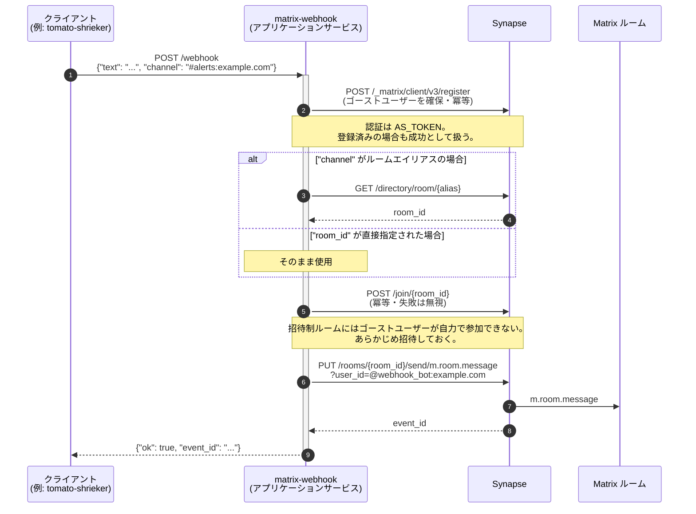

[日本語](README.ja.md) | [English](README.md)

# Matrix Webhook アプリケーションサービス

このリポジトリには、Matrix ルームにメッセージを送信するためのウェブフック機能を提供する Matrix アプリケーションサービスが含まれています。外部サービスが簡単な HTTP POST リクエストを通じて Matrix ルームにメッセージを送信できるようにします。

リクエストの形式は Slack の Incoming Webhooks に倣っています。そのため、Slack 互換の送信側をほとんど変更せずに Matrix へ向けられます。

## 処理の流れ



送信専用のサービスです。ルームの読み取りや、Synapse からのイベント受信は行いません。

---

## 目次

1. [前提条件](#前提条件)
2. [初期セットアップ](#初期セットアップ)
3. [環境変数](#環境変数)
4. [設定](#設定)
5. [サービスの実行](#サービスの実行)
6. [使用例](#使用例)

---

## 前提条件

- Docker & Docker Compose (v3.8+)
- 実行中の Matrix ホームサーバー (Synapse)
- Python 3.8+ (Docker なしで実行する場合)

---

## 初期セットアップ

1. このリポジトリをクローン
2. アプリケーションサービス設定ファイル `webhook_as.yaml` は matrix-server ディレクトリにあります。詳細については[こちら](https://github.com/bshock-matrix/matrix-server/blob/main/README.ja.md#g-webhook-%E3%82%A2%E3%83%97%E3%83%AA%E3%82%B1%E3%83%BC%E3%82%B7%E3%83%A7%E3%83%B3%E3%82%B5%E3%83%BC%E3%83%93%E3%82%B9)をご覧ください。

---

## 環境変数

`.env.example` を `.env` にコピーして、以下の変数を設定してください：

```bash
# Matrix Webhook 環境変数
MATRIX_URL=http://host.docker.internal:8008  # Matrix ホームサーバーの URL、例: https://matrix.org
SERVER_NAME=localhost                        # Matrix サーバー名、homeserver.yaml 設定の server_name と一致する必要があります
BOT_LOCALPART=webhook_bot                   # ボットのユーザー名ローカル部分
AS_TOKEN=<generated>                        # ランダムに生成されたアプリケーションサービストークン
```

これらの環境変数はウェブフックサービスの設定に使用されます。`.env` ファイルは安全に保管し、バージョン管理にコミットしないでください。

---

## サービスの実行

### Docker Compose を使用（推奨）

デタッチモードでサービスを開始：

```bash
docker-compose up -d
```

### Docker なし

1. 依存関係をインストール：

   ```bash
   pip install -r requirements.txt
   ```

2. サービスを実行：
   ```bash
   python main.py
   ```

デフォルトでは、サービスはポート 9000 でリッスンします。

---

## 使用例

### メッセージの送信

curl を使用してルームにメッセージを送信：

```bash
curl -X POST http://localhost:9000/webhook \
     -H 'Content-Type: application/json' \
     -d '{"text":"Webhook via AS works test!","channel":"#test:localhost"}'
```

成功レスポンス：

```json
{
  "ok": true,
  "event_id": "$VLnAIICMyUu8m39dA6lftWHz11B-WJzsRUtNuYg5mjQ"
}
```

### メッセージフォーマットオプション
> 注意: ウェブフックボットはパブリックルームに自動的に参加できます。プライベートルームの場合は、まずボットユーザーをルームに招待してください。ボットは自動的に招待を受諾します。

異なるフォーマットでメッセージを送信できます：

```bash
# HTML フォーマットメッセージ
curl -X POST http://localhost:9000/webhook \
     -H 'Content-Type: application/json' \
     -d '{
           "text": "<b>太字テキスト</b> and <i>斜体テキスト</i>",
           "channel": "#test:localhost",
           "format": "html"
         }'

# メンション付きプレーンテキスト
curl -X POST http://localhost:9000/webhook \
     -H 'Content-Type: application/json' \
     -d '{
           "text": "Hey @user:example.com, これをチェックしてください！",
           "channel": "#test:localhost"
         }'
```

---

## エラーハンドリング

サービスは適切な HTTP ステータスコードと JSON レスポンスを返します：

- 200: メッセージ送信成功
- 400: 無効なリクエストフォーマット
- 401: 認証失敗
- 404: ルームが見つからない
- 500: 内部サーバーエラー

エラーレスポンス例：

```json
{
  "ok": false,
  "error": "Room not found"
}
```